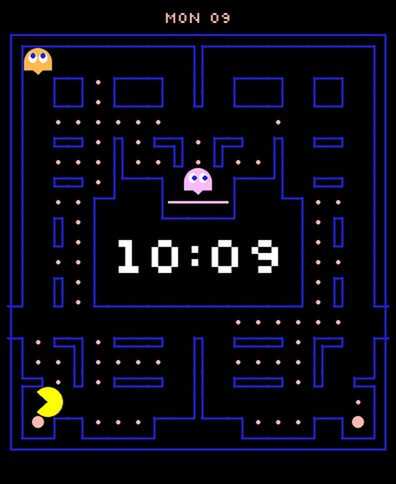
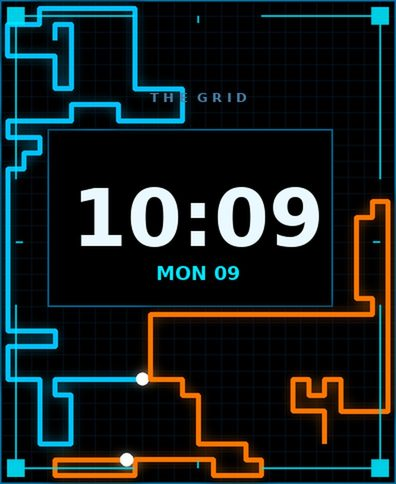
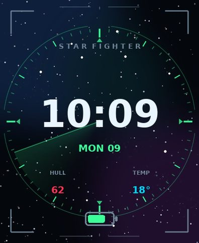
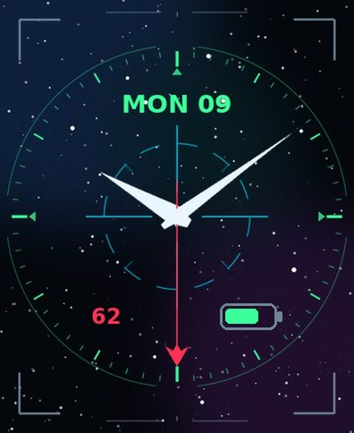

# Clockology watch faces

Custom Apple Watch faces for [Clockology](https://apps.apple.com/us/app/clockology/id1456386228),
generated from source — artwork, animation and the `.clock` container are all built
by the code in this directory.

| | | | |
|---|---|---|---|
|  |  |  |  |
| **Maze Chase** — an arcade maze game, clock in the ghost chamber | **Light Cycle** — a Tron-style match playing under the clock | **Star Fighter HUD** — digital, radar sweep on the second hand | **Star Fighter Analog** — swept fighter hands over a reticle |

The Star Fighter pair comes in **Green**, **Amber** and **Ice** across four watch
sizes; the two animated faces are 45mm. Everything in `dist/` is ready to install.

## Installing a face

1. Pick the file in [`dist/`](dist) matching your design, colourway and watch size —
   e.g. `StarFighterHUD-Green-45mm.clock`. Sizes map to watch models as:

   | File suffix | Models | Canvas |
   |---|---|---|
   | `41mm` | Series 7/8/9 41mm | 352 × 430 |
   | `45mm` | Series 7/8/9 45mm | 396 × 484 |
   | `46mm-s10` | Series 10/11 46mm | 416 × 496 |
   | `49mm-ultra` | Ultra / Ultra 2 / Ultra 3 | 410 × 502 |

   Other sizes (`40mm`, `42mm-s10`, `44mm`) can be built on demand — see below.

2. Get the file onto your iPhone: AirDrop it, email it, or drop it in iCloud Drive.
3. Open it and choose **Clockology** from the share sheet. It lands in the app's
   *Designs* list.
4. In Clockology, open the design and tap **Sync to Watch**.

The Clockology watch app must be running on the watch to display the face — it is a
third-party app, not a real watchOS face, so it cannot be set as your default face and
does not show on the wrist-raise until you open Clockology.

## What's on each face

**Maze Chase** (animated)

- A full arcade maze game loops under the clock: the hero clears every pellet while
  four ghosts hunt him with the arcade's own targeting rules, power pellets turn them
  blue, and the board flashes white when it is cleared — then a fresh board racks up
- The board is reshaped from the arcade's tall 28x31 to a 19x21 that suits a watch,
  and the ghost house in the middle is enlarged into an empty chamber holding the time
- Weekday and date ride the top band, where the arcade puts the score line
- Battery is included but **hidden by default**
- A 29-second H.264 loop (600 KB) on a `VideoTexture` layer

**Light Cycle** (animated)

- A full-face light cycle match looping underneath the clock: two cycles lay glowing
  ribbons across the grid until one is boxed in and derezzes, then a new round racks up
- Hours and minutes, large and centred, with a black outline so they stay readable
  over the action
- Weekday and date beneath, battery below that
- Heart rate is included but **hidden by default** — unhide it in the layer list
- The match is a 12-second H.264 loop (180 KB) on a `VideoTexture` layer set to loop
  forever. Built for 45mm; other sizes with `--designs tron --sizes 41mm`.

**Star Fighter HUD** (digital)

- Hours and minutes, large and centred
- Weekday and date beneath
- `HULL` — live heart rate
- `TEMP` — current temperature (needs Weather enabled in Clockology)
- Battery indicator at the bottom
- A translucent radar wedge rotating once a minute on the second hand

**Star Fighter Analog**

- Swept fighter-blade hour and minute hands
- A second hand carrying a small delta fighter at its tip
- Weekday and date at the top
- Heart rate with a heart icon, battery indicator opposite
- An Activity move ring around the dial, **hidden by default** — unhide it in the
  layer list if you want it

## The clock font

A font **cannot be embedded in a `.clock` file** — the format has no slot for one, so
the clock can only use a font already present on the device. Note that the binding
constraint is *watchOS*, not iOS: the face is drawn by the Clockology app on the watch,
and watchOS ships a much smaller font set than the phone. A font installed on the
iPhone through a configuration profile does not necessarily reach the watch.

(Clockology's newer `.clock2` format *can* carry fonts — third-party extractors pull
`.ttf` data straight out of those files. This project does not write `.clock2`.)

Build with any font name via `--font`, which fills the `customFont` field on the clock
layers:

```bash
python3 build.py --designs pacman --sizes 45mm --font Menlo
```

Square-ish candidates worth trying, most to least arcade-looking: **Krungthep**
(a Thai face whose Latin glyphs are blocky and squared-off), **Silom**, **Menlo**,
**Courier New**, **DIN Condensed**. `dist/` carries pre-built variants. If a named
font is missing on the watch the layer falls back, so the worst case is ordinary
digits, not a blank clock — but confirm on the wrist, and whichever renders, keep.

Clockology's own font picker is the real source of truth: open the face, tap the
**Readout: Time** layer, and the list shows exactly what that device can use, with a
live preview. Picking there is one tap and always works.

`assets/fonts/Silkscreen-Regular.ttf` is bundled (SIL Open Font License, text beside
it) as the closest free match to the arcade score font, for anyone who wants to try
installing it. The previews in `dist/previews/` are rendered with it, so they show the
intended look rather than the shipped default.

## Building from source

Requires Python 3.10+ and Pillow.

```bash
pip install Pillow
cd clockology
python3 build.py                              # every design, colourway and default size
python3 build.py --all                        # every supported size
python3 build.py --sizes 45mm --variants ice  # just one
python3 build.py --seed 42                    # reroll the starfield
```

Output goes to `dist/`, with a JPEG preview of each face in `dist/previews/`.

Building Light Cycle needs one more package for the encoder: `pip install imageio-ffmpeg`.

Layout is driven by tables in `clocklib/face.py` — `ANALOG_POS`, `HUD_POS`, `TRON_POS` —
which hold the `(x, y, scale)` of every readout. The layer graph and the preview
renderer both read those tables, so a preview always reflects the real composition.
Colourways live in `VARIANTS` and only repaint three accent slots of the palette.

Artwork in `clocklib/art.py` is drawn procedurally at 4× and resampled down, so any
canvas size comes out crisp; nothing is a fixed-resolution bitmap.

`clocklib/pacman.py` holds the maze game: the board, the hero's routing, the arcade
ghost targeting, the wall renderer and the encoder. The hero picks each move from two
BFS distance fields — one measured from every ghost, one from every remaining pellet —
and refuses any move into a pocket he could be sealed into, working that out from the
speed ratio between him and the ghosts. He still loses most matches, so `render_match`
searches seeds and animates the first clean win of a sensible length; that is what
makes "the hero always wins" true rather than hoped for.

`clocklib/lightcycle.py` holds the light cycle game: a grid simulation where each rider
picks its next turn by flood-filling the open space around each option, plus the frame
renderer and the ffmpeg call that encodes the loop. The clip opens and closes on black,
so it cycles without a visible seam.

### Inspecting a face

```bash
python3 inspect_clock.py dist/StarFighterHUD-Green-45mm.clock
python3 inspect_clock.py some.clock --layers          # full layer options
python3 inspect_clock.py some.clock --extract out/    # pull out the PNGs
```

This works on any `.clock` file, including ones exported from the Clockology app.

## The `.clock` file format

Worth writing down, because it is not documented anywhere and the common guess is wrong.

A `.clock` file is **not** a zip archive. It is an Apple **binary property list**
containing an `NSKeyedArchiver` object graph. The graph uses only `NSDictionary`,
`NSArray`, strings, numbers, booleans and raw data — no custom classes — so it can be
written from plain Python with `plistlib`. That is all `clocklib/archive.py` does.

The root object:

```
faceSetting         title, uniqueID, filterCategories, faceColors, lastUpdateDate, faceLayers
mediaAssets         [ { filename, assetData } ]   — PNG bytes, one per image layer
thumbnailImageData  JPEG bytes, rendered at 2x the canvas
syncModePreference  ""
```

Each entry in `faceLayers` carries a fixed key set — `layerType`, `customName`,
`layerOptions`, `desiredThemeColorIndex`, `horizontalPosition`, `verticalPosition`,
`scale`, `alpha`, `angleOffset`, `filenameForImage`, `isHidden`. Note that the numeric
fields are **strings** (`"1.0"`, `"-0.46"`); only `desiredThemeColorIndex` is a real
integer.

Conventions worth knowing:

- **Layer order is bottom to top.** The first element of `faceLayers` is the backdrop.
- **Positions are normalised from the centre**: horizontal runs −1 (left) to +1 (right),
  vertical runs −1 (bottom) to **+1 (top)** — y is positive *upwards*.
- **Image assets are always full canvas size**, whatever the layer is. A hand is drawn
  pointing at 12 o'clock across the whole canvas, with its pivot set by `imageXPos` /
  `imageYPos` (`0.5`, `0.5` for centre).
- **`desiredThemeColorIndex` indexes into `faceColors`.** An `ImageTexture` with
  `tinted: true` is recoloured by it, so greyscale artwork recolours for free — that is
  how one set of PNGs serves all three colourways.

Layer types seen in the wild: `ColorTexture`, `ImageTexture`, `GradientTexture`,
`VideoTexture`, `TextLabel`, `DateTimeLabel`, `HealthLabel`, `WeatherLabel`,
`HourHand`, `MinuteHand`, `SecondHand`, `ActivityRing`, `BatteryIndicator`, `Icon`,
`MoonPhase`, `Utility`.

**Animation** is a `VideoTexture` layer. Its `filenameForImage` names a `.mov` in
`mediaAssets` and `layerOptions.numberOfLoops` of `-1` loops forever. The asset must be
a **QuickTime** file — brand `ftypqt`, not `ftypisom` — carrying H.264 in `yuv420p`, so
ffmpeg needs `-f mov`. Unlike images, movie assets keep a readable filename rather than
a UUID.

## Known caveats

These faces were built and verified offline; they have not been opened on a physical
watch. The archive structure is sound — it round-trips byte-identically against faces
exported by Clockology itself, and `build.py` re-reads and validates every file it
writes. What could still need a nudge:

- **Text sizing.** Clockology's `scale` has no published reference size; the values here
  were calibrated from real faces, so a label may want resizing. Drag it in the app if so.
- **`Icon` and `BatteryIndicator` dimensions** are estimates for the same reason.
- **Battery drain.** Maze Chase and Light Cycle play video continuously whenever
  Clockology is open. Expect noticeably more power use than the still faces.
- **The clock font** is Clockology's own unless Silkscreen is installed — see above.
- **The weather readout** needs Weather permission granted to Clockology, otherwise it
  renders blank.

All of this is adjustable directly in the app — nothing requires a rebuild.

## Credit

Format details were reverse-engineered by reading the `.clock` files published in
[GoldenChaos/FacePorts](https://github.com/GoldenChaos/FacePorts). The artwork here is
generated from scratch and shares nothing with that project.
